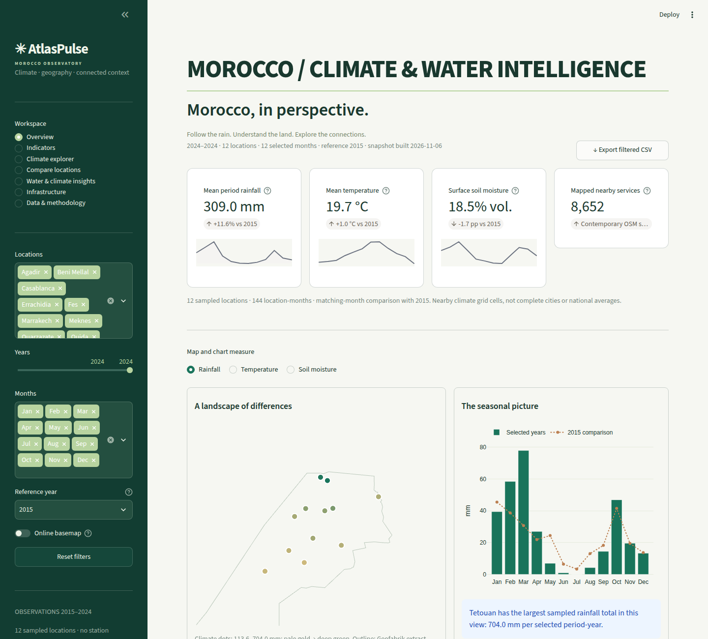
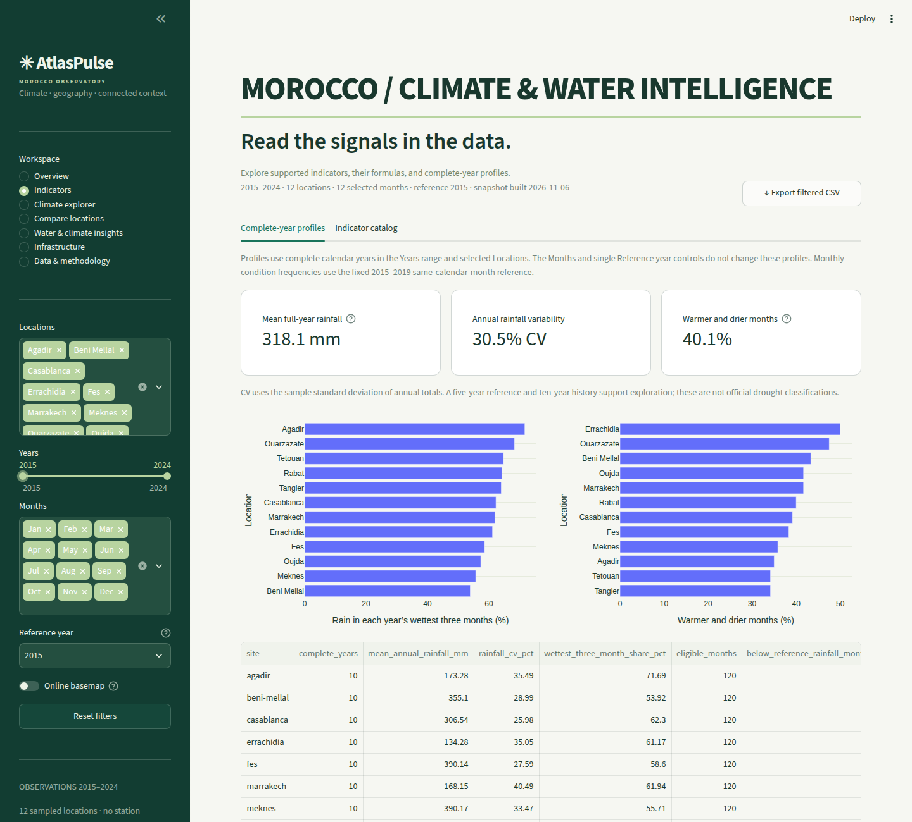
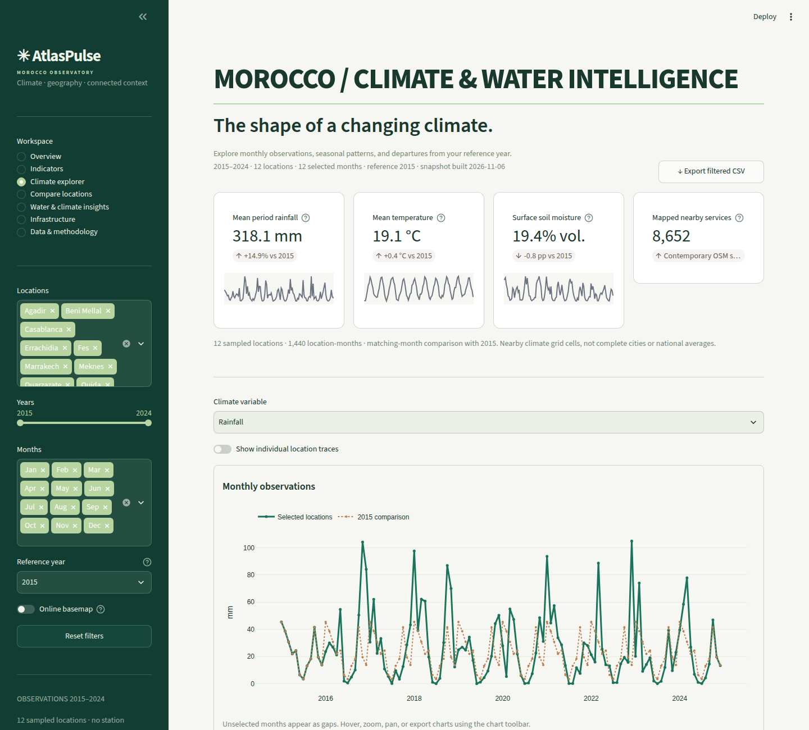
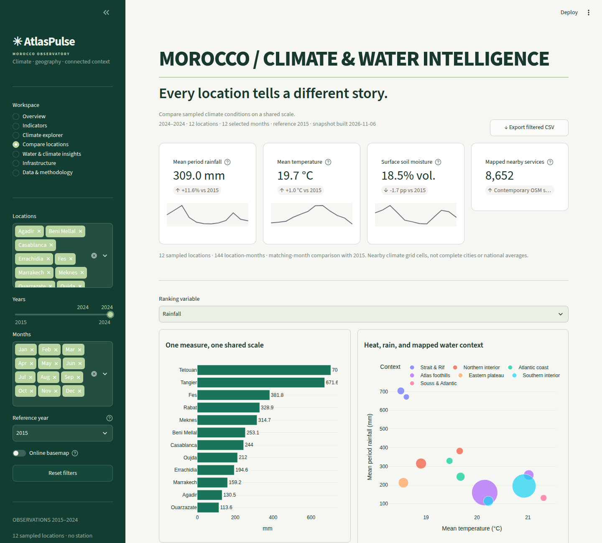
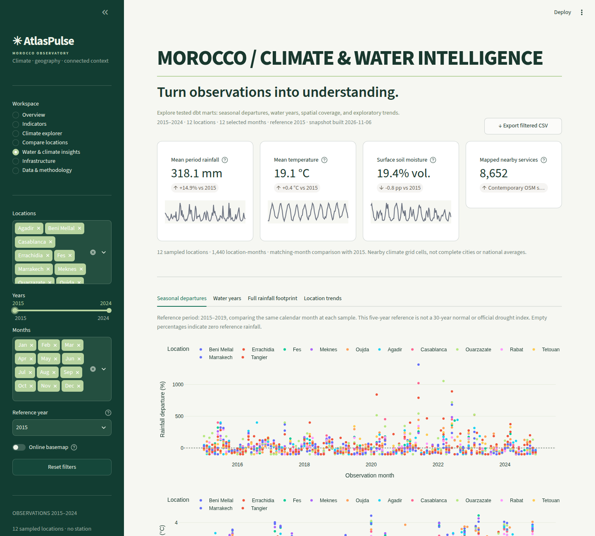
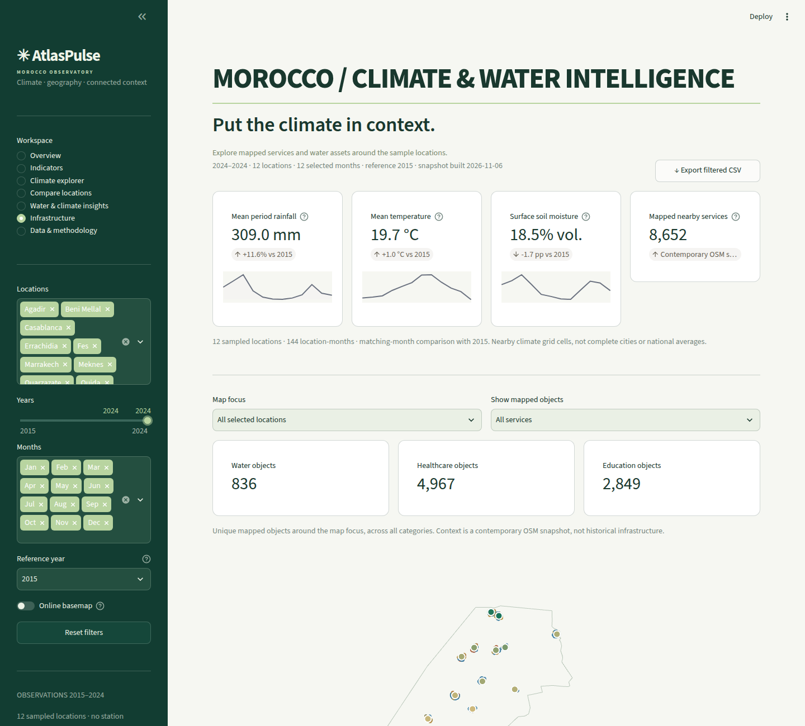
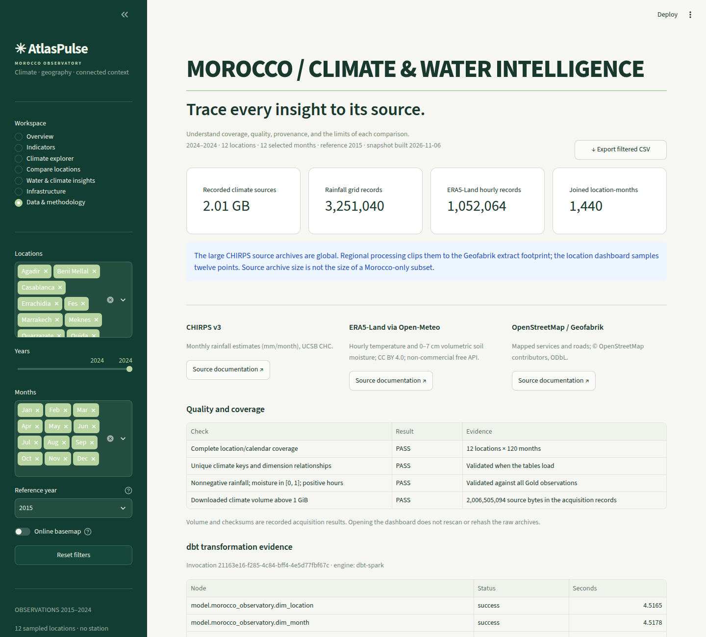
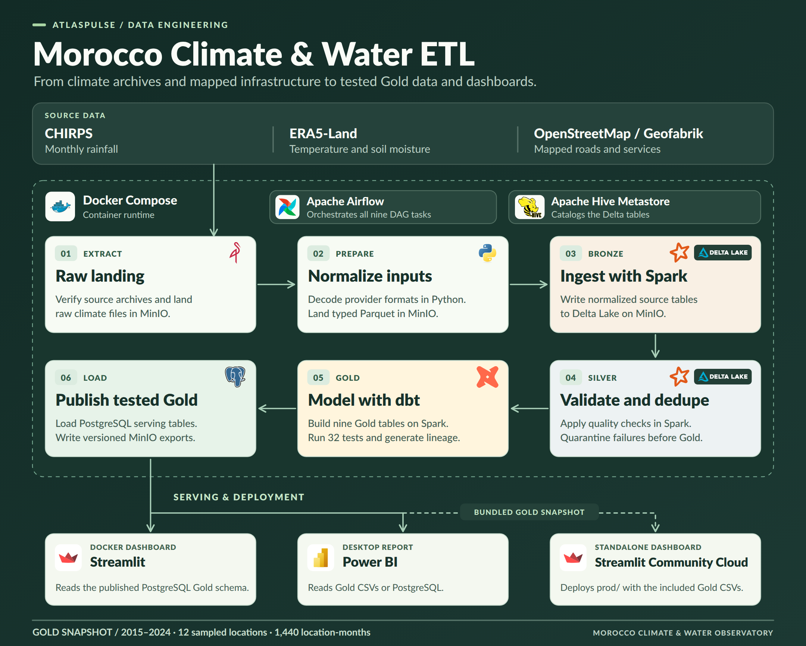

# Morocco Climate & Water Observatory

A Morocco data engineering project combining **CHIRPS rainfall**, **ERA5-Land temperature and soil moisture**, and **OpenStreetMap geography**. It uses **MinIO, Spark/Delta, Hive, dbt, Airflow and PostgreSQL**, with a native **Power BI** report and a detailed **Streamlit** companion dashboard.

Read the [architecture, analytical contracts and platform runbook](docs/morocco-platform.md) for each technology's role, service URLs, operations, data limitations and verification scope.

<!-- dashboard-screenshots:start -->
## Dashboard screenshots

Representative desktop views captured from the real dashboard by the source project’s automated screenshot workflow.



<details>
<summary>View the other six dashboard sections</summary>

### Indicators



### Climate explorer



### Compare locations



### Water & climate insights



### Infrastructure



### Data & methodology



</details>
<!-- dashboard-screenshots:end -->

## Actual data

The downloaded climate collection exceeds the requested 1 GB: **2,006,505,094 climate source bytes**, including ten CHIRPS annual archives totaling **1,975,021,368 bytes**. All 120 monthly time steps and rainfall units were checked, with recorded SHA-256 checksums. These are global provider archives; their size must not be presented as Morocco-only volume. See the [acquisition manifest](data/metadata/climate_downloads.json) and [verification report](data/metadata/verification.md).

Regional processing retains **3,251,040 rainfall grid records**, **1,052,064 ERA5-Land hourly records**, and **1,440 location-months** across twelve sampled locations, 2015–2024. The OSM extract contains **34,152,138 nodes** and **2,752,127 ways**. Total downloaded source volume is **2,250,780,578 bytes**.


## Medallion workflow



```text
CHIRPS / ERA5-Land / OSM -> MinIO Landing -> Spark Delta Bronze
  -> validated Silver -> dbt Gold -> PostgreSQL + versioned MinIO exports
  -> Power BI / Streamlit
Airflow orchestrates; Hive catalogs; Prometheus / Grafana / Loki monitor.
```

Seven source tables pass shared Silver type, range, finite-value, null and deduplication contracts. Invalid records enter quarantine and block publication. **dbt builds and tests nine Gold models**, including seasonal departures, October–September water-year totals, exploratory location trends, and area-weighted rainfall across the entire retained footprint. The local verification target is DuckDB; production uses Spark SQL and Delta on MinIO.

## Local transformation and dashboard

With Python 3.12:

```powershell
python -m pip install -r observatory/requirements-platform-local.txt -r dashboard/requirements.txt pytest
python observatory/warehouse.py local-all
python -m pytest
python -m streamlit run streamlit_app.py
```

This workspace also includes `./.tools/python/python.exe`, which can replace `python`. Open **http://localhost:8501**. The seven dashboard sections cover overview maps, timelines and heatmaps, comparisons, dbt climate/water insights, actual mapped infrastructure, and source/quality methodology. Filters and CSV/GeoJSON exports use published Gold observations. [Dashboard guide](dashboard/README.md).

Open **[powerbi/Morocco.pbip](powerbi/Morocco.pbip)** in Power BI Desktop, set the Gold folder parameter, and refresh. See the [Power BI guide](powerbi/README.md). Desktop rendering and DAX execution require verification in Power BI Desktop. Both tools use the same Gold fact/dimension definitions.

If inputs are missing, acquire them first; downloads are cached:

```powershell
python observatory/download_climate.py --start-year 2015 --end-year 2024
python observatory/verify_climate.py
python observatory/download_era5.py --start-year 2015 --end-year 2024
```

## Distributed platform

```powershell
python observatory/setup_platform.py
docker compose --env-file .env.morocco -f docker-compose.yml config --quiet
docker compose --env-file .env.morocco -f docker-compose.yml build spark-master
docker compose --env-file .env.morocco -f docker-compose.yml build
docker compose --env-file .env.morocco -f docker-compose.yml up -d --no-build
docker compose --env-file .env.morocco -f docker-compose.yml exec airflow-scheduler airflow dags test morocco_observatory
```

Use Docker Desktop with Linux containers and Compose 2.24+. The setup script generates private local credentials without overwriting existing configuration. Airflow is at port 8080, MinIO console at 9001, Grafana at 3000, and generated dbt docs at 8091. Streamlit reads the committed PostgreSQL Gold publication in this mode and becomes ready after the first successful publication. The [runbook](docs/morocco-platform.md) covers resource requirements, optional Superset/host-monitoring profiles, Power BI PostgreSQL access and the distributed smoke-test checklist.

Local SQL/data tests do not verify the distributed stack. Docker integration and Power BI Desktop rendering must be checked in their respective runtimes.

Recorded local verification: **11 dbt models and 32 dbt tests passed**, **10 dashboard/platform tests passed**, and **41 Power BI documents plus nine Gold source contracts passed validation**. Streamlit's HTTP health check returned 200. The [verification record](data/metadata/platform_verification.json) explicitly separates these results from the unexecuted Docker integration checks.

Verified Docker execution on **2026-11-06**: all nine Airflow stages succeeded through MinIO Landing, Spark/Delta Bronze and Silver, dbt Gold, and PostgreSQL publication. All 32 dbt tests passed, nine Gold tables reconciled between Spark and PostgreSQL, and all six Streamlit pages passed AppTest against PostgreSQL. Streamlit is served at `http://localhost:8501`; PostgreSQL is exposed on port `5433`. See [Docker verification](data/metadata/docker_verification.json).

## Project map

| Path | Purpose |
| --- | --- |
| `observatory/` | Acquisition, provider decoding, contracts, Spark layers and publication |
| `dbt/` | Staging views, Gold models, tests and lineage |
| `airflow/dags/` | Acquisition-to-publication DAG |
| `data/raw/` | Ignored original provider inputs |
| `data/metadata/` | Acquisition and execution evidence |
| `data/bronze/` | Ignored decoded local inputs |
| `data/warehouse/` | Ignored local verification warehouse |
| `data/gold/` | Small shared BI exports and provenance |
| `powerbi/` | Native report and semantic model |
| `dashboard/` | Interactive analytical app and MinIO reader |
| `monitoring/` | Metrics, alerts, logs and Grafana provisioning |

Climate values are estimated or modeled. Location samples are nearby grid cells, not complete cities or national averages. The short reference baseline and ten-year slopes support exploration, not official drought assessments or forecasts. OSM is contemporary mapped context, not historical infrastructure, service capacity or causal impact evidence.

## Sources

- [CHIRPS v3 — UCSB Climate Hazards Center](https://chc.ucsb.edu/data/chirps3)
- [Official CHIRPS annual monthly archives](https://data.chc.ucsb.edu/products/CHIRPS/v3.0/monthly/global/netcdf/by_year/)
- [ERA5-Land via Open-Meteo Historical Weather API](https://open-meteo.com/en/docs/historical-weather-api)
- [OpenStreetMap / Geofabrik Morocco extract](https://download.geofabrik.de/africa/morocco.html)


## Indicators and free Streamlit deployment

The [indicator guide](docs/indicators.md) documents 24 indicators, their formulas, measured findings and limits. The dashboard now includes an Indicators workspace. The [standalone `prod` package](prod/README.md) contains the dashboard and published Gold snapshot for Streamlit Community Cloud; no database credentials or pipeline services are required. Refresh it with `python observatory/analyze_indicators.py` followed by `python observatory/build_prod.py`.

## Refresh the dashboard screenshots

The screenshot script captures all seven dashboard sections, disables the optional
online basemap, selects representative year ranges, and updates the generated
image galleries in this README and `prod/README.md`. It also refreshes the production
ZIP and its manifest. Screenshots are committed in `docs/screenshots/` and
`prod/docs/screenshots/`; debug files stay in ignored `data/runtime/screenshots/`.

```bash
python -m pip install -r requirements-screenshots.txt -r prod/requirements.txt
python -m playwright install --only-shell chromium
python scripts/capture_dashboard.py
```

The default command starts and stops its own server using the bundled Gold snapshot.
To capture the running Docker dashboard, use:

```bash
python scripts/capture_dashboard.py --url http://localhost:8501
```

Use `--browser-executable /path/to/chromium` to use an installed Chromium-based
browser. Use `--no-readme` to export only the images. On a minimal Linux machine, Playwright
may require its operating-system libraries: `python -m playwright install-deps chromium`.
The capture process fails on an unavailable dataset and only replaces the gallery
when every screenshot succeeds. Repeated runs update the same README block.
