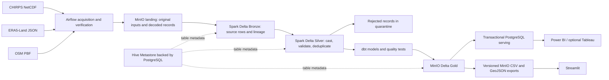

# Morocco data platform: architecture and runbook

This project combines rainfall estimates, hourly land reanalysis, and mapped infrastructure. Its canonical transformation path is **MinIO → Spark/Delta Bronze → Spark/Delta Silver → dbt Gold → PostgreSQL and versioned BI exports**. Airflow runs the stages in order. Power BI Desktop and the companion Streamlit app consume the same Gold definitions.

## Data and scope

| Input | Retained source | Analytical records | Interpretation |
| --- | --- | --- | --- |
| CHIRPS v3 monthly rainfall | 10 global NetCDF archives, 2015–2024; 1,975,021,368 bytes | 3,251,040 footprint cell-months; 1,440 sampled location-months | Estimated precipitation, mm/month |
| ERA5-Land via Open-Meteo | 10 annual multi-location JSON files; 31,483,726 bytes | 1,052,064 hourly observations | Modeled 2 m temperature and 0–7 cm volumetric soil moisture |
| OpenStreetMap / Geofabrik | Morocco PBF and footprint; 244,275,484 bytes | 34,152,138 nodes and 2,752,127 ways scanned | Contemporary mapped services and road context |

The climate source volume is **2,006,505,094 bytes**, strictly above 1 GiB. Global archive volume must not be described as Morocco-only data size. Derived copies and MinIO replicas do not count toward the acquisition requirement. The twelve sample locations do not represent population-weighted or complete national coverage. The Geofabrik extract footprint defines the spatial rainfall mart; it is not an authoritative administrative boundary.

## Medallion architecture



The Docker DAG uploads verified raw inputs to MinIO before decoding. The decoder retrieves them from the committed raw manifest, checks their SHA-256 values, and rebuilds normalized records; Spark reads those records from MinIO.

**Landing** retains provider originals in private `landing/observatory/raw/` objects. Python decodes NetCDF, provider JSON and OSM formats into source records under `landing/observatory/normalized/`. Decoding and geographic selection happen before Bronze; climate joins, monthly land-variable aggregation and analytical marts happen in dbt.

**Bronze** stores the seven decoded source tables as Delta in `s3a://bronze/observatory/{table}`. Every record includes `_ingested_at`, `_source_file`, and `_row_hash`. Original files remain in Landing for replay. Full refreshes are deliberate for this bounded historical dataset; the current implementation does not claim incremental processing or CDC.

**Silver** uses shared contracts in `observatory/contracts.py`. It casts source types, enforces keys and valid physical ranges, rejects null/non-finite measurements, and deduplicates deterministically by source business key and lineage. Rejected records are stored in `s3a://silver/observatory/_quarantine/{table}` with a reason. Any rejected row fails the task and blocks Gold publication. Accepted source records live in `s3a://silver/observatory/{table}`. dbt relationship and reconciliation tests catch losses during joins.

**Gold** is produced by `dbt`, with the Spark Thrift adapter in the cluster and a DuckDB adapter for local verification. Production dbt tables are Delta in the Gold bucket, registered in Hive. The two staging models are views.

## Technology responsibilities

| Technology | Concrete use | Entry point |
| --- | --- | --- |
| Python | Provider decoding, acquisition verification, publication, dashboard | `observatory/`, `dashboard/` |
| MinIO / S3A | Originals, normalized inputs, Delta layers, committed BI snapshots | `observatory/storage.py` |
| Apache Spark | Distributed Bronze/Silver processing and SQL execution | `observatory/spark_medallion.py` |
| Delta Lake | Transaction logs and schema-aware layer tables | Spark 3.5.3 + Delta 3.2.1 |
| Hive Metastore | Shared Bronze/Silver/Gold table catalog | Hive 3.1.3, PostgreSQL metadata |
| dbt | Monthly climate joins, dimensions, analytical marts, lineage, tests | `dbt/` |
| Airflow | Monthly scheduled workflow, retries, logs, publication dependency gates | `airflow/dags/morocco_observatory.py` |
| PostgreSQL | Separate Airflow/Hive/Superset databases and `observatory.gold` tables | `docker/postgres/init.sh` |
| Power BI | Native report and semantic model; CSV or PostgreSQL import | `powerbi/Morocco.pbip` |
| Streamlit / Plotly / Pydeck | Detailed interactive analytical companion | `streamlit_app.py` |
| Redis | Short-lived committed-snapshot pointer cache; optional Superset cache | Streamlit MinIO backend |
| Superset | Optional SQL exploration of the read-only serving schema | Compose `exploration` profile |
| Prometheus / StatsD | Source volume, DQ, row counts, task metrics, SQL and storage scrapes | `monitoring/` |
| Grafana | Provisioned operational panels and Airflow log view | `Morocco · Data Platform Operations` |
| Loki / Promtail | Airflow task log collection, including Spark/dbt command output | Mounted Airflow log directory |
| Alertmanager | DQ, dependency, volume and publication alerts to a local log receiver | `observatory/metrics.py` |
| Node Exporter / cAdvisor | Optional Linux VM/container host resource metrics | Compose `linux-host` profile |
| dbt docs | Generated dependency graph and model catalog | Local port 8091 after DAG success |
| Docker Compose | Reproducible service topology and persistent named volumes | `docker-compose.yml` |


## Gold contracts and analytical value

| Table | Grain | Purpose |
| --- | --- | --- |
| `dim_location` | One requested sample location | Coordinates, names, climate-context labels |
| `dim_month` | One calendar month | Date filtering and BI relationships |
| `fact_climate_monthly` | Location × month | CHIRPS rainfall joined to hourly ERA5-Land monthly means and actual hour counts |
| `fact_infrastructure` | Location | Nearby mapped water, healthcare, education counts and road km |
| `source_audit` | Climate dataset × year | Original file path, byte count and SHA-256 |
| `mart_monthly_anomalies` | Location × month | Same-calendar-month departures from the configured 2015–2019 reference |
| `mart_water_year` | Location × water-year ending | October–September rainfall total and hour-weighted land variables; complete-year flag |
| `mart_site_trends` | Location | OLS rainfall mm/year and temperature °C/decade slopes from complete calendar years |
| `mart_spatial_rainfall` | Footprint × month | Area-weighted mean rainfall from the full regional grid, valid-cell count and approximate coverage km² |

The monthly anomaly mart avoids comparing a wet-season month to an annual mean. It publishes percentage rainfall departures, standardized rainfall departures, temperature differences in °C, and soil moisture changes in percentage points. A five-year reference is short: these are exploratory departures, **not SPI, an official drought classification, or a 30-year climate normal**. Division by a zero reference mean or standard deviation returns NULL.

Water years are labeled by the ending year: October 2023–September 2024 is water year 2024. Boundary years 2015 and 2025 are incomplete and explicitly flagged. The Streamlit chart excludes incomplete years while the table retains their coverage flags.

Trend models use ten complete calendar years. Slopes are descriptive; no significance test, causal inference or forecast is claimed. Spatial means use `cos(latitude)` weights, proportional to cell area for the regular 0.05° grid. They represent the retained extract footprint, independently of the twelve-location selection.

Infrastructure counts come from mapped OSM nodes and way centers within 20 km. Road lengths use segment midpoint inclusion, not exact polygon clipping. Overlapping neighborhoods may count the same object in multiple location contexts. Counts are not service capacity, completeness, historical exposure or population risk. No unsupported impact score is manufactured from climate and infrastructure.

## Run locally without Docker

Use Python 3.12 and a virtual environment. This workspace also includes `.tools/python/python.exe`; substitute it for `python` if necessary.

```powershell
python -m pip install -r observatory/requirements-platform-local.txt -r dashboard/requirements.txt pytest
python observatory/warehouse.py local-all
python -m pytest
python -m streamlit run streamlit_app.py
```

This runs provider decoding, a local Bronze/Silver verification warehouse, **real dbt models and tests against the downloaded inputs**, and exports Gold. The local warehouse is `data/warehouse/observatory.duckdb`. DuckDB execution verifies SQL/data behavior; it does not verify Spark, MinIO, Hive, Airflow or PostgreSQL integrations. Local data paths are ignored by Git except the small Gold exports and evidence files.

If source files are missing, acquire them first:

```powershell
python observatory/download_climate.py --start-year 2015 --end-year 2024
python observatory/verify_climate.py
python observatory/download_era5.py --start-year 2015 --end-year 2024
```

The decoder also fetches the Geofabrik PBF/footprint if absent. Downloads are cached. Remove/rebuild corresponding derived artifacts when changing the site definition, source archives or decoding logic; the current decoder cache is intended for the fixed 2015–2024 project scope.

For individual stages, use `warehouse.py prepare`, `local-silver`, `dbt`, or `export`. `export` requires a successful build artifact; `local-all` is the normal entry point. The older `observatory/pipeline.py` retains provider decoder functions; its compatibility CLI now delegates to the same dbt workflow, so there is no alternative Python-only Gold path.

## Start the distributed platform

Docker keeps raw inputs, decoded files and normalized Bronze inputs in persistent
`raw_cache`, `processed_cache` and `bronze_cache` volumes. This avoids large working
file writes on the checkout drive. The parent `data/` bind still receives metadata
and published Gold exports. MinIO initialization prepares cache ownership for
`AIRFLOW_UID`; the acquisition task fills an empty raw cache from the providers.
Airflow logs and shared Hive client libraries also use Docker volumes. The default
network is named `observatory-net` so Hive's canonical hostnames are valid URIs.

Use Docker Desktop with Linux containers, Compose **2.24 or later**, around 16 GB RAM and at least 25 GB free Docker storage. The MinIO replica and image layers require additional disk beyond the existing source archives. These are development services bound to loopback, not a public deployment.

```powershell
python observatory/setup_platform.py
docker compose --env-file .env.morocco -f docker-compose.yml config --quiet
docker compose --env-file .env.morocco -f docker-compose.yml build spark-master
docker compose --env-file .env.morocco -f docker-compose.yml build
docker compose --env-file .env.morocco -f docker-compose.yml up -d --no-build
docker compose --env-file .env.morocco -f docker-compose.yml exec airflow-scheduler airflow dags list-import-errors
docker compose --env-file .env.morocco -f docker-compose.yml exec airflow-scheduler airflow dags test morocco_observatory
```

`setup_platform.py` creates random local credentials in ignored `.env.morocco`, retains an existing file, and prints no secrets. Open the file locally for login credentials. PostgreSQL init scripts run only on a new volume. If reusing a previously initialized volume, create the databases/roles through a migration; changing environment passwords does not rotate existing database roles. This stack uses its own Compose project and volume namespace.

The DAG is initially paused. Run `make docker-pipeline` for a synchronous end-to-end run inside the scheduler container; this executes the real tasks and records the DAG run in Airflow. Unpause in Airflow to enable scheduled runs or queued manual triggers. Monthly runs occur at 04:00 UTC on the first day. It has one active run, bounded task timeouts, and two retries with three-minute delay. The run refreshes/verifies the fixed historical input scope; it does **not** automatically extend observations beyond 2024 or refresh cached OSM extracts. Publication freshness measures pipeline execution, not observation recency.

Spark and Delta versions are paired. Hive runs Java 8; Spark uses Java 17. S3A dependencies match each runtime's Hadoop 3.3.4 libraries. Spark resolves its Hive 3.1.3 client jars from Maven on first catalog use; allow outbound Maven access for that initialization. Provider requests also require network access when inputs are absent.

| Interface | Local URL | Login |
| --- | --- | --- |
| Streamlit | http://localhost:8501 | Local analytical app |
| Airflow | http://localhost:8080 | `admin`, generated `AIRFLOW_ADMIN_PASSWORD` |
| Spark master | http://localhost:8082 | Local Spark UI |
| Spark SQL UI | http://localhost:4040 | Active Thrift application |
| MinIO console | http://localhost:9001 | Generated MinIO credentials |
| Grafana | http://localhost:3000 | `admin`, generated `GRAFANA_PASSWORD` |
| Prometheus | http://localhost:9090 | Local metric queries |
| Alertmanager | http://localhost:9093 | Local alert state |
| dbt docs | http://localhost:8091 | Generated after dbt documentation task |
| Superset, optional | http://localhost:8088 | `admin`, generated `SUPERSET_ADMIN_PASSWORD` |

The PostgreSQL-backed dashboard shows an actionable unavailable state until the first publication succeeds. To explore the existing local exports in Docker before running the cluster, override the Streamlit backend to `local`, mount `data` at `/workspace/data`, or use the native local command above.

Enable Superset with `--profile exploration` on the Compose `up` command. Its initializer registers the read-only **Morocco Gold (read only)** PostgreSQL connection automatically; select it and schema `gold` in SQL Lab. It has read access only. No legacy Superset dashboards are imported. On Linux, `--profile linux-host` enables Node Exporter and cAdvisor. On Docker Desktop those metrics describe the Linux VM/container environment, not native Windows host utilization; the optional scrape targets are down while that profile is disabled.

Stop services without deleting data:

```powershell
docker compose --env-file .env.morocco -f docker-compose.yml down
```

Do not add `-v` unless you intend to delete the platform's persistent volumes.

## Publication and consumers

The publisher refuses failed or warned dbt builds. It reads Gold through Spark Thrift, uploads all CSV/GeoJSON files to a new `exports/observatory/runs/{publication_id}/` prefix, and verifies uploaded size and SHA-256 metadata. It replaces serving tables together in **one PostgreSQL transaction**, reconciles row counts, grants read-only BI access and creates a unique climate key index. It writes `exports/observatory/current.json` last. Streamlit follows that commit pointer, verifies downloaded checksums, and caches the complete immutable snapshot. Redis may cache the pointer for 15 seconds; Streamlit rechecks it every 30 seconds.

PostgreSQL and MinIO do not share a distributed transaction. If the database commit succeeds but writing the pointer fails, PostgreSQL may temporarily contain a newer publication than MinIO; retry the publication task to reconcile. Previous committed MinIO snapshots remain readable. Local CSV mirror files are replaced individually after commit and are a convenience for Desktop refresh, not a multi-file transactional storage format. Avoid refreshing Desktop while a local export is being replaced.

Open `powerbi/Morocco.pbip`, set the Gold folder parameter to this checkout, and refresh. Existing dimension and fact column contracts are preserved. The native Power BI semantic model imports all four analytical marts and includes a fourth insights page. Streamlit also consumes those marts. For PostgreSQL import in Power BI/Tableau, connect to `localhost:5433` (override with `POSTGRES_HOST_PORT`), database `observatory`, schema `gold`, user `bi_reader`, using the generated password. Do not use the metadata administrator account for BI.

## Streamlit analytical workspace

The six sections cover overview maps, detailed climate timelines/heatmaps, location comparisons, dbt water/climate insights, mapped infrastructure, and source/quality methodology. Global controls select locations, years, months, and a matching-month reference year. Reference-year comparisons and the fixed dbt baseline are explicitly distinct. Water-year and full-history trend views state which filters they use. Empty filters are handled explicitly; zero rainfall baselines yield undefined percentages instead of infinities. Filtered CSV and GeoJSON downloads preserve the underlying observations.

Online CARTO basemap tiles are optional. Turn off the basemap for a plain background; local observations, footprint and assets remain available. Map points show requested sample locations; exports include exact CHIRPS and ERA5 grid coordinates.

## Quality gates and evidence

- Source acquisition: completed files, strict >1 GiB climate gate, SHA-256, NetCDF monthly dimensions and rainfall units.
- Silver: finite measurements, type/range/null contracts, deterministic deduplication and persisted quarantine; any rejected row blocks progress.
- dbt: uniqueness, not-null, dimension relationships, physical ranges, complete site/month coverage, leap-year-aware monthly hours, and source-to-Gold rainfall/hour/infrastructure reconciliation.
- Analytical marts: water-year rainfall conservation, centered baseline departures, and consistent regional grid coverage.
- BI publication: build success, serving row-count reconciliation, object size/checksum validation and a commit pointer.
- Dashboard tests: real Gold loading, reference-month matching, hour-weighted aggregation, zero-denominator handling, all pages, filter changes and empty-state recovery.

`data/metadata/silver_verification.json`, `dbt_run_results.json`, Gold `provenance.json`, and `snapshot.json` record actual local results. Production success is recorded separately in `metadata/publication.json`. Do not treat a local DuckDB build or static Compose inspection as a successful distributed pipeline run.


## Monitoring and troubleshooting

Grafana is provisioned with Prometheus and Loki sources. Metrics distinguish climate source bytes from derived sizes, accepted layer counts, quarantine records, dbt failures, committed publication time, dependency TCP reachability, and Postgres availability. Airflow emits StatsD task metrics; Spark task durations and row counts use explicit mapped names. Promtail tails Airflow logs, which include subprocess output from Spark/dbt. Alertmanager sends to an internal local log receiver; no email, Slack, or external recipients are configured.

Inspect DAG logs first when a stage fails. Invalid records are queryable in `quarantine` through Spark SQL; fix the source/contract issue and retry rather than bypassing tests. Review `dbt/target/run_results.json` and generated lineage for failed models/tests. A down optional host scrape is expected without `linux-host`. Internal TCP probes do not prove application-level query correctness.

The core Docker data path was verified on 2026-11-06; see `data/metadata/docker_verification.json` for all nine successful Airflow stages, MinIO Delta commits, Spark/PostgreSQL reconciliation, and Streamlit checks. Monitoring services and Power BI Desktop rendering remain separate verification scopes. To repeat the data-path smoke run: build images, inspect DAG import errors, trigger the DAG, confirm Delta logs in each MinIO layer, inspect dbt results, query PostgreSQL as `bi_reader`, open the PostgreSQL-backed dashboard, and confirm monitoring targets/logs. Power BI Desktop rendering and DAX execution also require Desktop verification.

## Source attribution and technical references

- [UCSB Climate Hazards Center: CHIRPS v3](https://chc.ucsb.edu/data/chirps3)
- [Open-Meteo Historical Weather API](https://open-meteo.com/en/docs/historical-weather-api): ERA5-Land request parameters and attribution. Free API use is non-commercial; observe its terms for deployment.
- [OpenStreetMap copyright and ODbL](https://www.openstreetmap.org/copyright), [Geofabrik Morocco](https://download.geofabrik.de/africa/morocco.html)
- [dbt Spark setup](https://docs.getdbt.com/docs/local/connect-data-platform/spark-setup)
- [Delta Lake release compatibility](https://docs.delta.io/releases/)
- [Spark Hive metastore configuration](https://spark.apache.org/docs/3.5.6/sql-data-sources-hive-tables.html)
- [Airflow 2.10.5 Docker guide](https://airflow.apache.org/docs/apache-airflow/2.10.5/howto/docker-compose/index.html)
- [Streamlit AppTest](https://docs.streamlit.io/develop/api-reference/app-testing/st.testing.v1.apptest)
