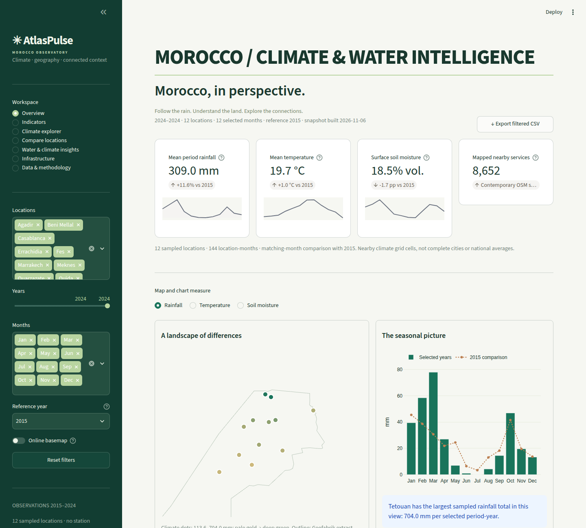
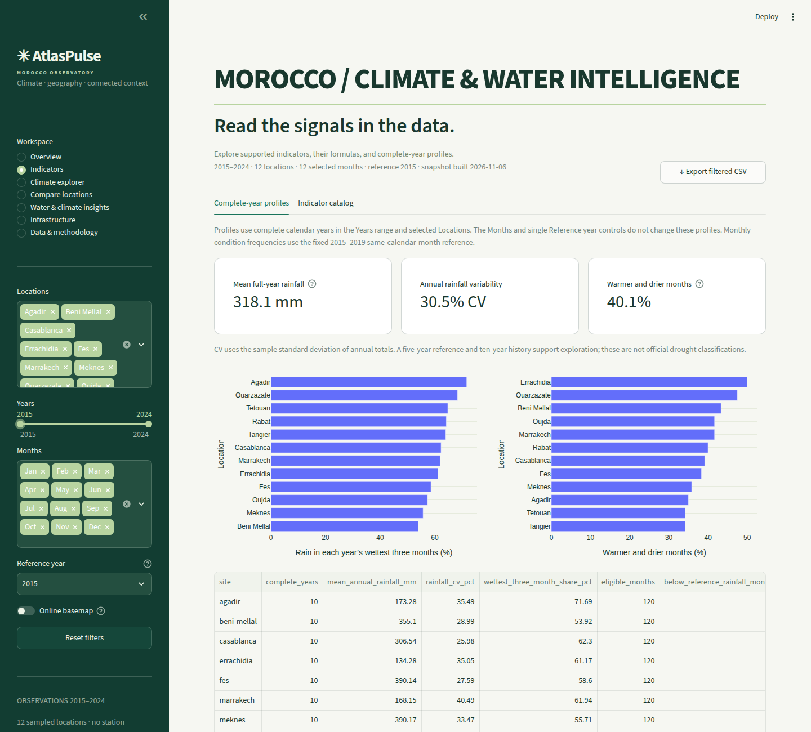
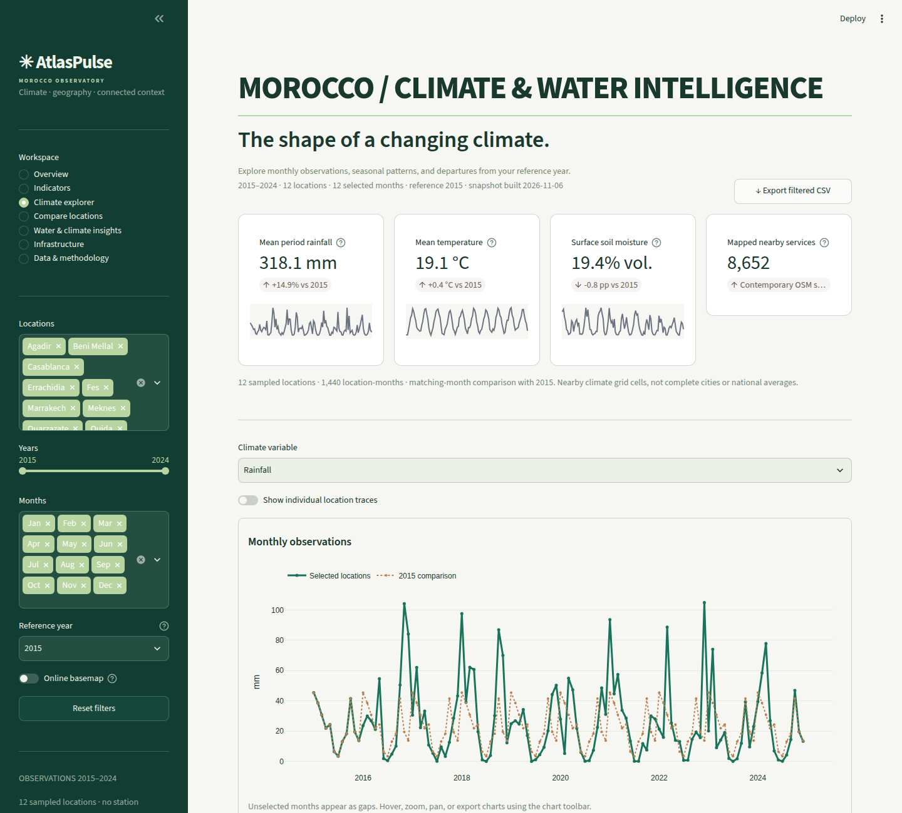
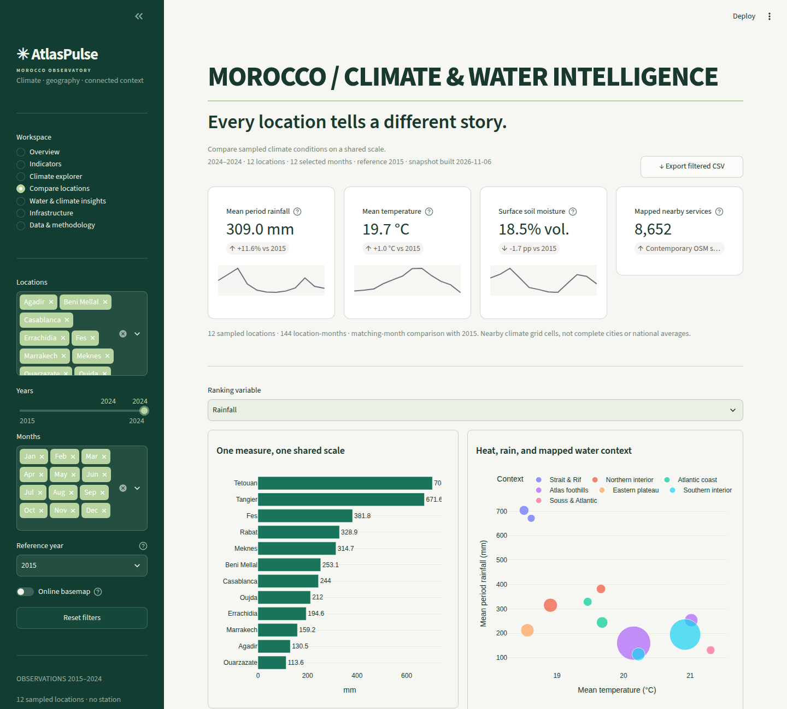
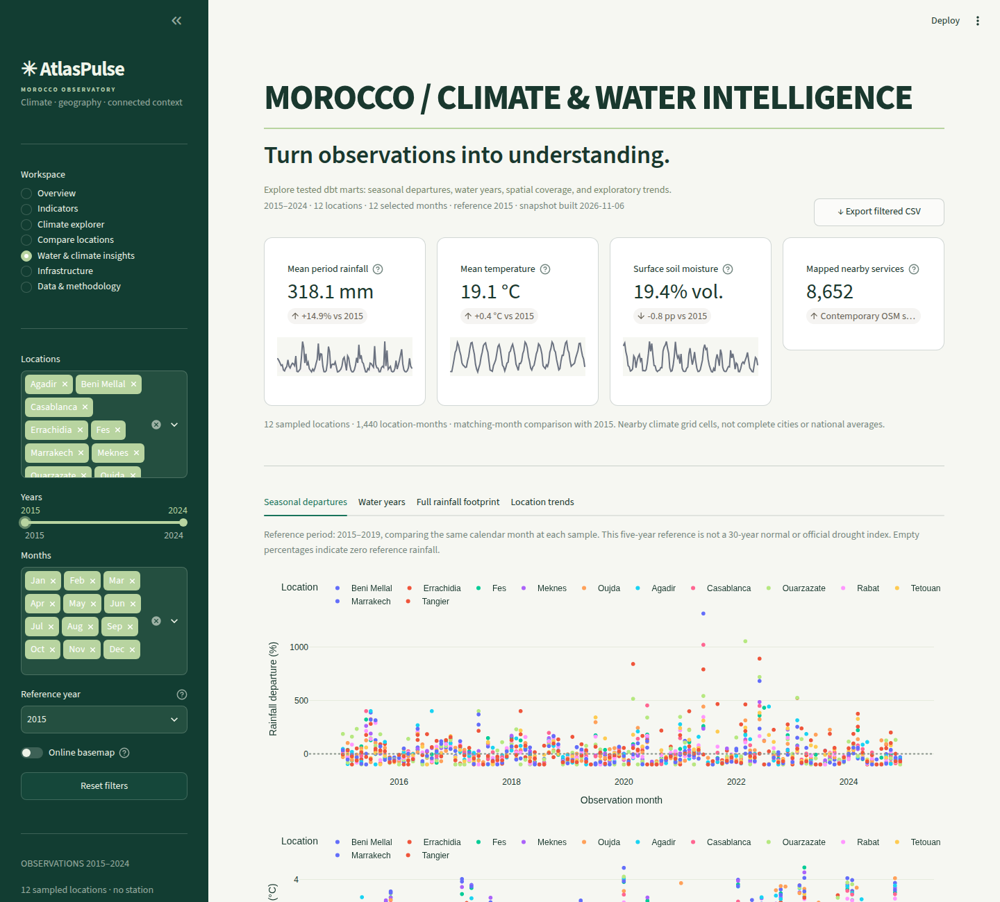
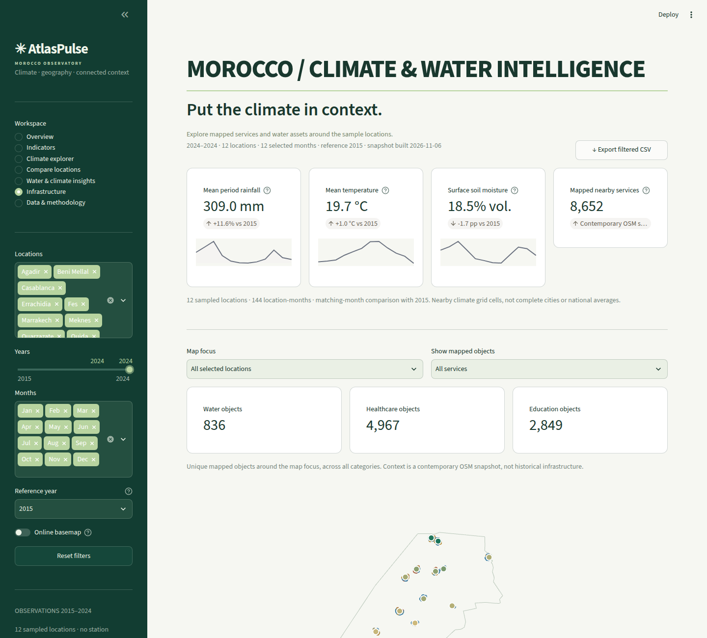
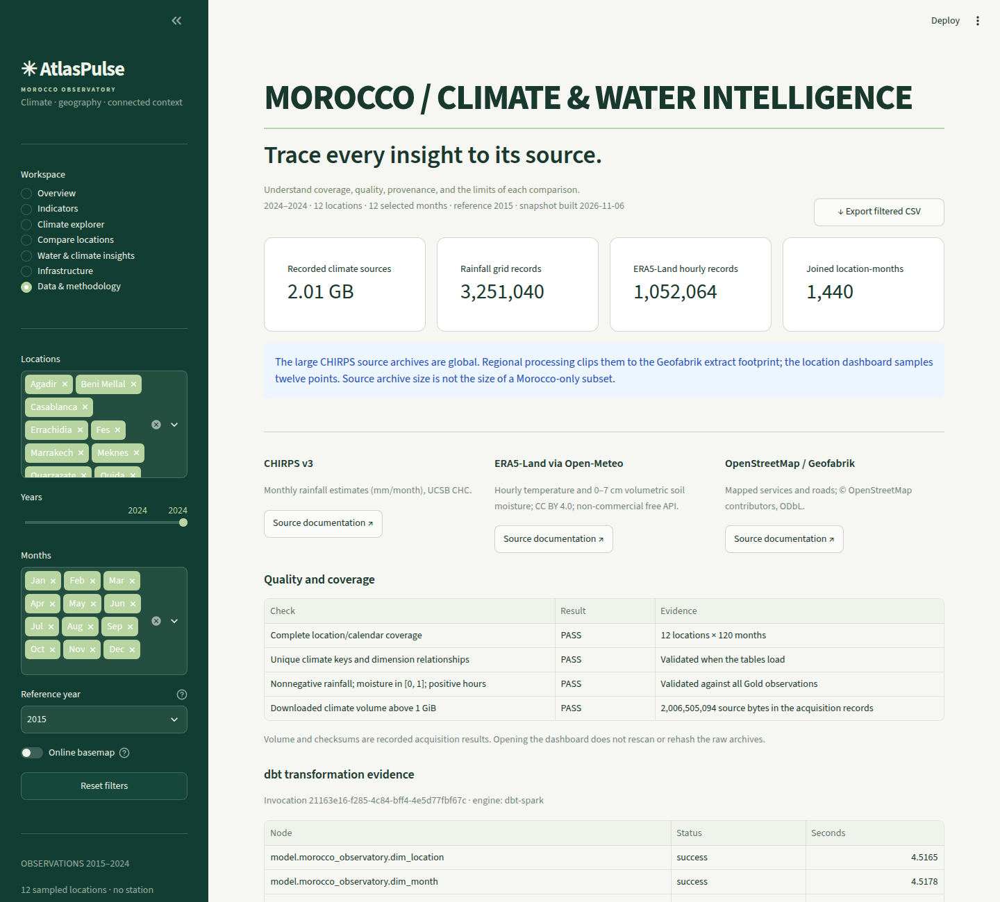

# Deploy AtlasPulse on Streamlit Community Cloud

This self-contained folder includes the dashboard, nine published Gold CSV tables,
map geometry, source attribution, calculation documentation and quality evidence.
It reads a fixed, published 2015–2024 snapshot. It needs no database credentials,
PostgreSQL, MinIO, Spark, Airflow, raw archives or paid external service.

## Recommended: deploy this folder as its own repository

1. Create a GitHub repository and put the **contents of this folder** at its root.
   Include the hidden `.streamlit/config.toml` file, the `data/` folder and the
   `dashboard/` package. `streamlit_app.py` should be at repository root.
2. Sign in to [Streamlit Community Cloud](https://share.streamlit.io/), choose
   **Create app**, then select your repository and branch.
3. Set **Main file path** to `streamlit_app.py`.
4. In **Advanced settings**, select **Python 3.12**. Leave Secrets empty.
5. Choose your app URL and click **Deploy**.

Community Cloud offers free hosting and runs the application from GitHub. Its
runtime limits and availability policies can change; this bundle is approximately
3–4 MB, with only a small published dataset loaded into memory.

If deploying from the original full repository instead, select
`prod/streamlit_app.py` and keep `prod/requirements.txt` beside it. Community Cloud
runs from repository root: copy this folder's `.streamlit/config.toml` to the
repository-root `.streamlit/config.toml` in your deployment branch as well. The
entrypoint resolves its data relative to its own file, independently of cwd.

## Run locally

```bash
python -m pip install -r requirements.txt
python -m streamlit run streamlit_app.py
```

Open http://localhost:8501. The optional online CARTO basemap can be turned off;
all observations, local geometry, charts and exports remain available.

## Update the published dataset

This app serves the packaged snapshot, not a live database. In the source project,
finish a successful pipeline publication, then run:

```bash
python observatory/analyze_indicators.py
python observatory/build_prod.py
```

Commit the refreshed app/data files to your deployment repository. Community Cloud
redeploys code and data changes from GitHub. `bundle_manifest.json` records file
sizes, SHA-256 checksums, table row counts and the source publication ID.
The ZIP created by the builder contains this folder's contents at archive root.

See [INDICATORS.md](INDICATORS.md) for 24 supported indicators, formulas, measured
findings and interpretation limits. The two analysis CSV files are in
`data/analysis/`. Source attribution is preserved in the dashboard and Gold assets.

## Official deployment references

- [Free Community Cloud hosting](https://docs.streamlit.io/deploy/streamlit-community-cloud)
- [Repository and entrypoint setup](https://docs.streamlit.io/deploy/streamlit-community-cloud/deploy-your-app/deploy)
- [File organization](https://docs.streamlit.io/deploy/streamlit-community-cloud/deploy-your-app/file-organization)
- [App dependencies](https://docs.streamlit.io/deploy/streamlit-community-cloud/deploy-your-app/app-dependencies)


<!-- dashboard-screenshots:start -->
## Dashboard screenshots

Representative desktop views captured from the real dashboard by the source project’s automated screenshot workflow.



<details>
<summary>View the other six dashboard sections</summary>

### Indicators



### Climate explorer



### Compare locations



### Water & climate insights



### Infrastructure



### Data & methodology



</details>
<!-- dashboard-screenshots:end -->

